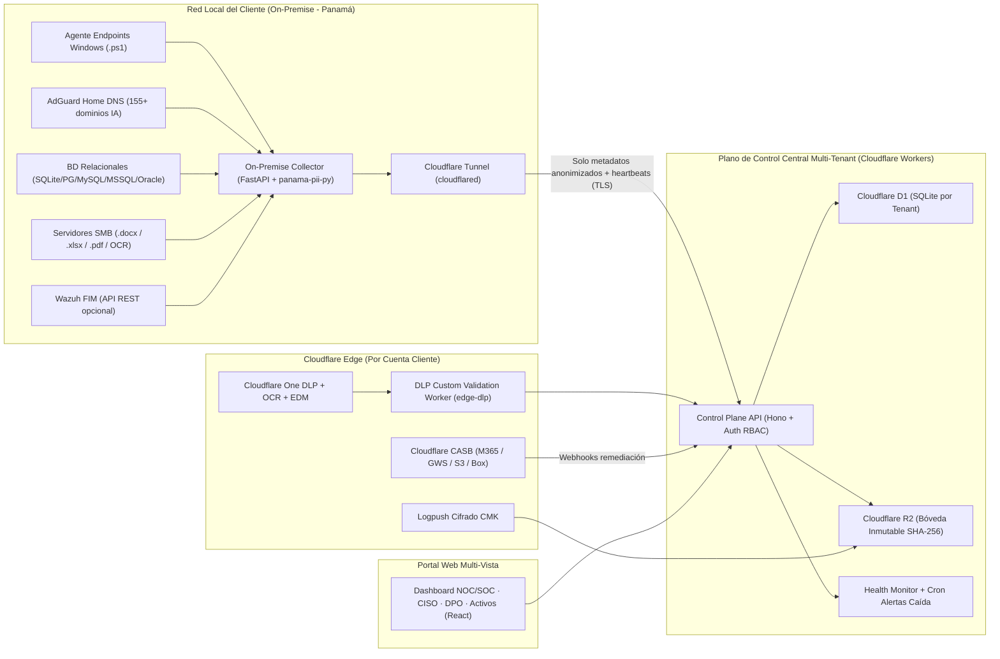

# Vektor81 v2 — Plataforma Híbrida de Auditoría Automatizada de Privacidad (Ley 81 de Panamá) & Monitoreo Shadow AI / CISO / SOC

**Vektor81 v2** implementa una arquitectura híbrida **Partner-led sobre Cloudflare + Recolector On-Premise** adaptada específicamente a la **Ley 81 de 2019**, su reglamentación en el **Decreto Ejecutivo No. 285 de 2021** (ANTAI), el **Acuerdo No. 001-2022 de la Superintendencia de Bancos de Panamá (SBP)** y la **Ley 68 de 2003** (sector salud).

---

## Arquitectura Híbrida



### Principios de Diseño
- **Soberanía y Minimización (Art. 41.4 Ley 81):** Los registros en BD y archivos SMB se procesan localmente en memoria; únicamente salen metadatos anonimizados, muestras enmascaradas (`8-8***34`) y hashes SHA-256 hacia el plano de control.
- **Paridad Determinista Python ↔ TypeScript ↔ PowerShell:** Un único corpus compartido ([panama_pii_test_vectors.json](packages/shared-contracts/panama_pii_test_vectors.json)) valida cédulas (`1-13`, `AV`, `PI`, `PE`, `E`, `N`, `NT`), vector **RUCTB de 20 posiciones + Módulo 11 (2 dígitos)** de la DGI, veto de fechas (`DD-MM-YYYY`), exclusión de **personas jurídicas / sociedades anónimas**, contexto sensible de salud/CSS/biometría, pasaporte APAP, tarjetas Luhn y SWIFT `PA`.
- **Observabilidad en Tiempo Real (NOC/SOC + CISO + DPO):** Monitoreo de latencia y estado (`ONLINE`, `DEGRADED`, `OFFLINE`, `STALE`) de las 11 capas, alertas automáticas por caída/desconexión, KPIs ejecutivos (**MTTD**, **MTTR**, cobertura %, remediación CASB %, exposición `B/. 1,000–10,000`), reloj de brechas **72h (DE 285 Art. 37 y 48.3)**, gestor **ARCO-P** con días hábiles de Panamá (5/10 días) y generación inmutable de **Ficha Técnica** en R2 con SHA-256.

---

## Estructura del Monorepo

| Ruta | Descripción |
| :--- | :--- |
| `packages/shared-contracts/` | Contratos compartidos TypeScript/JSON Schema y corpus `panama_pii_test_vectors.json` |
| `packages/panama-pii-py/` | Motor Python puro (RUCTB DGI, validadores, enmascaramiento, adaptador opcional Presidio/spaCy) |
| `packages/panama-pii-ts/` | Motor TypeScript espejo exacto de `panama-pii-py` |
| `edge-dlp/` | Cloudflare DLP Custom Validation Worker (`DlpValidationEntrypoint` con `@cloudflare/zt-types`) |
| `control-plane/` | Plano de control multi-tenant (Cloudflare Workers + Hono + D1 + R2 + Cron + Auth RBAC) |
| `onprem-collector/` | Recolector local FastAPI (`.docx`/`.xlsx`/`.pdf`/OCR, SMB, BD SQL, AdGuard vivo, Wazuh, cola store-and-forward y PDF WeasyPrint) |
| `agents/` | Agente endpoint Windows (`Vektor81-EndpointCollector.ps1`) con validación Panamá, Box/OneDrive, extensiones `<all_urls>`, HTTPS obligatorio y suite `Test-EndpointCollector.ps1` |
| `frontend/` | Dashboard React + Vite + Tailwind + Recharts (`Salud & Monitoreo`, `Centro CISO`, `Cumplimiento DPO`, `Activos & Tenants`) |
| `infra/` | Módulos Terraform Cloudflare `~> 5.0`, CLI de aprovisionamiento Tenant API (`provision-tenant.mjs`) y validador estático de reglas DLP/CWL (`validate-terraform-rules.mjs`) |
| `docs/checkpoints/` | Bitácora verificada por oleadas (`wave-0` a `wave-3`) |

---

## Inicio Rápido en Local (Desarrollo y Demostración)

### 1. Plano de Control (Cloudflare Workers + D1/R2 local)
```powershell
cd control-plane
npm install
npx wrangler d1 migrations apply vektor81-db --local -y
npx wrangler dev --port 8787 --local
```
- Asegúrate de definir `VEKTOR81_DEV_API_KEY=vektor81-local-dev-token` en `control-plane/.dev.vars` (ver `.dev.vars.example`).
- En el Dashboard (o vía API), puedes poblar los 3 tenants de ejemplo (`banco-istmo` SBP, `clinica-pacifica` Ley 68, `bufete-balboa` ANTAI) con `POST /api/v2/admin/seed-demo`.

### 2. Recolector On-Premise (Python + FastAPI)
```powershell
cd onprem-collector
python -m venv .venv
.\.venv\Scripts\python.exe -m pip install -r requirements.txt
$env:ONPREM_API_TOKEN="vektor81-local-dev-token"
$env:CONTROL_PLANE_URL="http://127.0.0.1:8787"
$env:COLLECTOR_TOKEN="vektor81-local-dev-token"
$env:TENANT_ID="banco-istmo"
.\.venv\Scripts\uvicorn.exe app.main:app --host 127.0.0.1 --port 8000
```

### 3. Dashboard CISO / SOC / DPO (Frontend)
```powershell
cd frontend
npm install
npm run dev
```
Abre `http://localhost:5173`. Vite redirige automáticamente `/api/v2` al Control Plane (`127.0.0.1:8787`) y `/api/v1` al On-Premise Collector (`127.0.0.1:8000`).

### 4. Despliegue On-Premise Completo con Docker Compose + Tunnel
Copia `.env.example` a `.env`, configura tus tokens y ejecuta:
```bash
# Sin túnel Cloudflare (solo LAN local)
docker compose up -d --build

# Con Cloudflare Tunnel hacia el Plano de Control
docker compose --profile tunnel up -d --build
```
*(La imagen Docker de `onprem-collector` incluye `WeasyPrint`, `Tesseract OCR (spa)`, `Presidio` y `spaCy es_core_news_lg`.)*

### 5. Agente Windows (Estaciones de Trabajo)
```powershell
# Prueba local segura sin transmitir
powershell -ExecutionPolicy Bypass -File agents\Vektor81-EndpointCollector.ps1 -DryRun -TenantId "banco-istmo"

# En producción (HTTPS obligatorio + Bearer token)
powershell -ExecutionPolicy Bypass -File agents\Vektor81-EndpointCollector.ps1 `
  -CollectorUrl "https://collector.empresa.pa" `
  -CollectorToken "<TOKEN>" `
  -TenantId "banco-istmo"
```

---

## Conexión a una Cuenta Real de Cloudflare (Producción Partner/MSSP)

1. **Autenticación Wrangler:**
   ```bash
   npx wrangler login
   ```
2. **Crear D1 y R2 reales para el Plano de Control:**
   ```bash
   cd control-plane
   npx wrangler d1 create vektor81-db
   npx wrangler r2 bucket create vektor81-evidence
   # Actualizar database_id en control-plane/wrangler.toml
   npx wrangler d1 migrations apply vektor81-db --remote
   npx wrangler secret put VEKTOR81_BOOTSTRAP_ADMIN_SECRET
   npx wrangler deploy
   ```
3. **Desplegar el DLP Custom Validation Worker en la cuenta del cliente:**
   ```bash
   cd edge-dlp
   npx wrangler deploy
   ```
4. **Aprovisionar cuentas aisladas y políticas Zero Trust / CASB / Logpush / Tunnel con Terraform v5:**
   ```bash
   node infra/scripts/validate-terraform-rules.mjs
   node infra/scripts/provision-tenant.mjs --name "Banco Istmo" --tenant-id "banco-istmo" --profile "SBP_001_2022"
   cd infra/terraform/environments/example-tenant
   terraform init && terraform apply
   ```
5. **Conectar el Recolector On-Premise vía `cloudflared`:** Configurar `CLOUDFLARE_TUNNEL_TOKEN`, `CONTROL_PLANE_URL`, `COLLECTOR_TOKEN` y `TENANT_ID` en `.env` y levantar `docker compose --profile tunnel up -d`.

---

## Suite Completa de Pruebas y Validaciones

| Componente | Comando de Verificación |
| :--- | :--- |
| Motor PII Python | `python -m unittest discover -s packages/panama-pii-py/tests -v` |
| Motor PII TypeScript | `cd packages/panama-pii-ts && npm test && npx tsc --noEmit` |
| Edge DLP Worker | `cd edge-dlp && npm test && npx tsc --noEmit` |
| Control Plane Workers | `cd control-plane && npm test && npx tsc --noEmit` |
| Terraform / Reglas DLP | `node infra/scripts/validate-terraform-rules.mjs` |
| On-Premise Collector | `onprem-collector\.venv\Scripts\python.exe -m unittest discover -s onprem-collector/tests -v` |
| Agente Windows PowerShell | `powershell -ExecutionPolicy Bypass -File agents/Test-EndpointCollector.ps1` |
| Dashboard Frontend | `cd frontend && npm test && npx tsc --noEmit && npm run build` |
